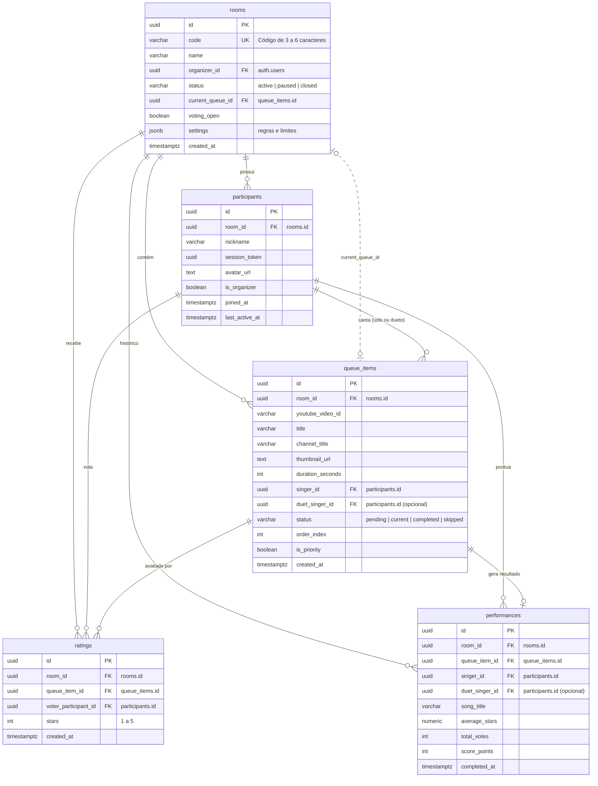

# Karaokê da Festa — Documentação do Backend & Supabase

> **Documento de Referência Técnica — Backend Developer**  
> Versão do Schema: `001_initial_schema.sql`  
> Compatibilidade: Supabase / PostgreSQL 14+

---

## 1. Visão Geral da Arquitetura

O backend do **Karaokê da Festa** é implementado sobre o **Supabase**, utilizando o **PostgreSQL** como motor relacional, **Row Level Security (RLS)** para governança de acesso, **Stored Procedures (RPCs) em PL/pgSQL** para garantir regras de negócio atômicas e **Supabase Realtime** para sincronização instantânea de filas, votos, participantes e reações ao vivo.

### 1.1 Modelo Híbrido de Sessão (Zero-Friction Party Mode)
- **Participantes (Mobile-first):** Não exigem criação de conta prévia. Ao ler o QR Code ou digitar o código da sala de 6 dígitos, o browser gera um `session_token` (UUID v4) persistido no `localStorage`. Esse token é vinculado à sala e ao apelido escolhido, permitindo reconexão transparente caso a página seja recarregada.
- **Organizadores / TVs:** Podem se conectar autenticados via Supabase Auth (`auth.users`) ou atuar como participantes com flag `is_organizer = true`.
- **Integridade Transacional:** Regras críticas (submissão de notas, cálculo de pontuação, avanço de fila e bloqueio de auto-voto) são executadas através de **RPCs com `SECURITY DEFINER`**, impedindo adulterações diretamente nas tabelas por clientes anônimos.

---

## 2. Diagrama Entidade-Relacionamento (ERD)



---

## 3. Especificação das Tabelas e Índices

### 3.1 `rooms`
Armazena as configurações e o estado ao vivo da sala do evento.
- **Constraints:**
  - `code`: `UNIQUE NOT NULL`, tamanho entre 3 e 6 caracteres (`check_room_code_len`).
  - `status`: `'active'`, `'paused'`, `'closed'`.
  - `current_queue_id`: FK para `queue_items(id) ON DELETE SET NULL`.
- **Configurações padrão (`settings` JSONB):**
  ```json
  {
    "max_songs_per_user": 3,
    "allow_duets": true,
    "vote_duration_seconds": 30,
    "auto_play": false
  }
  ```

### 3.2 `participants`
Participantes presentes na sala.
- **Constraints:**
  - `UNIQUE (room_id, nickname)`: impede dois participantes com o mesmo apelido na mesma sala.
  - `UNIQUE (room_id, session_token)`: vincula um único participante por dispositivo/token em cada sala.
- **Índices:**
  - `idx_participants_room_id` em `(room_id)`
  - `idx_participants_session` em `(room_id, session_token)`
  - `idx_participants_active` em `(room_id, last_active_at)`

### 3.3 `queue_items`
Músicas enfileiradas para apresentação no karaokê.
- **Constraints:**
  - `status`: `'pending'`, `'current'`, `'completed'`, `'skipped'`.
  - `check_diff_duet_singer`: `duet_singer_id IS NULL OR duet_singer_id <> singer_id` (impede auto-dueto).
- **Índices:**
  - `idx_queue_items_room_status_order` em `(room_id, status, is_priority DESC, order_index ASC)`
  - `idx_queue_items_singer` em `(singer_id)`
  - `idx_queue_items_duet` em `(duet_singer_id)`

### 3.4 `ratings`
Votos pontuais de 1 a 5 estrelas submetidos pelo público durante a janela aberta de votação.
- **Constraints:**
  - `stars`: `CHECK (stars >= 1 AND stars <= 5)`.
  - `unique_vote_per_participant`: `UNIQUE (queue_item_id, voter_participant_id)` (garante estritamente **1 voto por participante** por música).
- **Índices:**
  - `idx_ratings_queue_item` em `(queue_item_id)`
  - `idx_ratings_room_voter` em `(room_id, voter_participant_id)`

### 3.5 `performances`
Resultados históricos e consolidados das apresentações para montagem dos placares e rankings.
- **Constraints:**
  - `unique_performance_per_queue_item`: `UNIQUE (queue_item_id)` (garante idempotência e impede duplicação de pontuação para o mesmo show).
  - `check_diff_performance_duet`: `duet_singer_id IS NULL OR duet_singer_id <> singer_id`.
- **Índices:**
  - `idx_performances_room` em `(room_id, completed_at DESC)`
  - `idx_performances_singer` em `(singer_id)`
  - `idx_performances_duet` em `(duet_singer_id)`

---

## 4. Políticas de Segurança (Row Level Security - RLS)

Todas as 5 tabelas possuem RLS ativado. O modelo é aberto para leitura pública (`anon` e `authenticated`), garantindo que o display da TV e os dispositivos dos participantes recebam dados e eventos em tempo real sem atrito. As mutações de dados críticas de regras de negócio são protegidas por stored procedures `SECURITY DEFINER`.

| Tabela | Operação | Regra / Política | Propósito |
|---|---|---|---|
| `rooms` | `SELECT` | `USING (true)` | Todos os convidados e telão podem ler detalhes da sala. |
| `rooms` | `INSERT` | `WITH CHECK (true)` | Permite que organizadores (com ou sem conta) criem salas. |
| `rooms` | `UPDATE` | Organizer Auth ou participante moderador | Permite pausar/fechar sala e alterar configurações. |
| `rooms` | `DELETE` | Organizer Auth (`organizer_id = auth.uid()`) | Exclusão restrita ao criador da sala. |
| `participants`| `SELECT` | `USING (true)` | Lista de cantores pública para a sala. |
| `participants`| `INSERT / UPDATE` | `WITH CHECK (true)` | Conexão/reconexão (gerenciada preferencialmente por RPC). |
| `queue_items` | `SELECT` | `USING (true)` | Visualização da fila em tempo real no telão e no app. |
| `queue_items` | `INSERT / UPDATE` | `WITH CHECK (true)` | Inserção/atualização (gerenciada por RPC). |
| `ratings` | `SELECT` | `USING (true)` | Leitura para agregação de votos ao vivo. |
| `ratings` | `INSERT` | `WITH CHECK (true)` | Inserção auditada estritamente pela RPC `rpc_submit_rating`. |
| `performances`| `SELECT` | `USING (true)` | Exibição de histórico e estatísticas. |

---

## 5. Especificação Completa das Stored Procedures (RPCs)

### 5.1 `rpc_join_room`
Registra a entrada de um participante em uma sala ou reconecta uma sessão existente.
- **Assinatura:**
  ```sql
  rpc_join_room(
    p_room_code VARCHAR,
    p_nickname VARCHAR,
    p_session_token UUID,
    p_avatar_url TEXT DEFAULT NULL,
    p_is_organizer BOOLEAN DEFAULT FALSE
  ) RETURNS JSONB
  ```
- **Regras de Negócio:**
  1. Busca insensível a maiúsculas/minúsculas no código da sala (`UPPER(code)`).
  2. Rejeita salas com status `'closed'`.
  3. Se `(room_id, session_token)` já existir:
     - Reconecta o usuário.
     - Atualiza `last_active_at = NOW()`.
     - Atualiza apelido (caso o novo apelido não esteja em conflito) e avatar.
     - Retorna `{ "reconnected": true, "participant": {...}, "room": {...} }`.
  4. Se for novo participante:
     - Valida se o `nickname` já não está em uso nesta sala (`unique_nick_per_room`).
     - Insere o participante e retorna `{ "reconnected": false, "participant": {...}, "room": {...} }`.

### 5.2 `rpc_add_to_queue`
Adiciona uma música à fila de apresentações da sala.
- **Assinatura:**
  ```sql
  rpc_add_to_queue(
    p_room_id UUID,
    p_participant_id UUID,
    p_youtube_video_id VARCHAR,
    p_title VARCHAR,
    p_channel VARCHAR DEFAULT NULL,
    p_thumb TEXT DEFAULT NULL,
    p_duration INT DEFAULT 0,
    p_duet_singer_id UUID DEFAULT NULL
  ) RETURNS JSONB
  ```
- **Regras de Negócio:**
  1. Valida se a sala existe e não está encerrada.
  2. Valida se o cantor e o parceiro de dueto pertencem à mesma sala.
  3. Verifica configuração de duetos da sala: se `settings->>'allow_duets' = false`, rejeita dueto.
  4. Impede dueto consigo mesmo (`duet_singer_id <> singer_id`).
  5. Valida o limite de músicas ativas por usuário (`settings->>'max_songs_per_user'`, padrão 3).
  6. Calcula o próximo `order_index` atômico sequencial: `COALESCE(MAX(order_index), 0) + 1`.
  7. Insere o item na fila com status `'pending'` e retorna `{ "queue_item": {...}, "order_index": N }`.

### 5.3 `rpc_submit_rating`
Submete a avaliação de 1 a 5 estrelas do público durante a apresentação.
- **Assinatura:**
  ```sql
  rpc_submit_rating(
    p_room_id UUID,
    p_queue_item_id UUID,
    p_voter_participant_id UUID,
    p_stars INT
  ) RETURNS JSONB
  ```
- **Regras de Negócio e Validações de Segurança:**
  1. `p_stars` deve ser inteiro entre 1 e 5.
  2. Valida se `rooms.voting_open = TRUE`. Se a votação estiver fechada, lança exceção com código `P0007`.
  3. Valida se o item da fila pertence à sala informada.
  4. Valida se o votante pertence à sala.
  5. **Anti Auto-Voto:** Impede que o cantor principal (`singer_id`) ou o integrante do dueto (`duet_singer_id`) votem na própria apresentação.
  6. **Voto Único:** Garante que cada participante vote no máximo 1 vez por música.
  7. Insere o voto e retorna parciais atualizadas: `{ "rating": {...}, "total_votes": N, "average_stars": 4.80 }`.

### 5.4 `rpc_finish_performance`
Encerra a apresentação atual, consolida a pontuação e avança a fila.
- **Assinatura:**
  ```sql
  rpc_finish_performance(
    p_room_id UUID,
    p_queue_item_id UUID
  ) RETURNS JSONB
  ```
- **Regras de Negócio:**
  1. Bloqueia a linha da fila (`FOR UPDATE`) para evitar concorrência.
  2. Fecha a votação na sala imediatamente (`rooms.voting_open = FALSE`).
  3. **Idempotência:** Se já existir registro em `performances` para este `queue_item_id`, retorna o resultado existente sem duplicar pontuação (`"already_finished": true`).
  4. Calcula média de estrelas (`average_stars`) e total de votos (`total_votes`).
  5. **Fórmula de Pontuação:**
     $$\text{score\_points} = \text{ROUND}(\text{average\_stars} \times 100) + (\text{total\_votes} \times 10)$$
     *(Se total de votos for 0, a pontuação é 0).*
  6. Insere 1 único registro na tabela `performances` contendo `singer_id`, `duet_singer_id` e a pontuação consolidada.
  7. Atualiza `queue_items.status = 'completed'`.
  8. Busca a próxima música pendente na fila (`status = 'pending'`, ordenada por `is_priority DESC, order_index ASC`).
  9. Atualiza `rooms.current_queue_id` com a próxima música (ou `NULL` se a fila estiver vazia).
  10. Retorna `{ "performance": {...}, "next_queue_id": "...", "next_song_title": "..." }`.

### 5.5 `rpc_get_rankings`
Gera os rankings consolidados da sala em duas seções: Individual e de Duplas.
- **Assinatura:**
  ```sql
  rpc_get_rankings(
    p_room_id UUID
  ) RETURNS JSONB
  ```
- **Estrutura do Retorno:**
  ```json
  {
    "individual": [
      {
        "participant_id": "uuid-1",
        "nickname": "Alice",
        "avatar_url": "https://...",
        "total_points": 740,
        "songs_sung": 2,
        "average_stars": 4.70
      }
    ],
    "duets": [
      {
        "duet_key": "uuid-1:uuid-2",
        "singer1": { "id": "uuid-1", "nickname": "Alice" },
        "singer2": { "id": "uuid-2", "nickname": "Bob" },
        "total_points": 520,
        "songs_sung": 1,
        "average_stars": 4.80
      }
    ]
  }
  ```
- **Regra do Dueto no Ranking Individual:**
  - O cálculo faz `UNION ALL` entre apresentações solo e duetos.
  - Tanto o cantor principal quanto o parceiro do dueto recebem a **pontuação integral** da música e têm a contagem de músicas cantadas incrementada em 1, sem duplicar registros na tabela `performances`.
- **Regra de Agrupamento de Duplas:**
  - Duetos entre o Participante A e o Participante B são agrupados na mesma `duet_key` normalizada (`LEAST(A, B) : GREATEST(A, B)`), independentemente de quem escolheu a música.

### 5.6 RPCs Auxiliares
- `rpc_set_current_song(p_room_id UUID, p_queue_item_id UUID)`: Define manualmente a música atual, marca o item como `'current'` e atualiza a sala.
- `rpc_toggle_voting(p_room_id UUID, p_voting_open BOOLEAN)`: Abre ou fecha a janela de votação para a música atual.
- `rpc_reorder_queue(p_room_id UUID, p_queue_item_ids UUID[])`: Reordena a fila de músicas respeitando a nova sequência do organizador.

---

## 6. Supabase Realtime & Canais de Sincronização

A publicação `supabase_realtime` e a configuração `REPLICA IDENTITY FULL` foram aplicadas às tabelas: `rooms`, `participants`, `queue_items`, `ratings` e `performances`.

### 6.1 Canal Principal da Sala (`room:${roomId}`)
O frontend deve conectar no canal correspondente ao ID da sala:

```typescript
const channel = supabase.channel(`room:${roomId}`, {
  config: {
    broadcast: { ack: true },
    presence: { key: participantId }
  }
});
```

### 6.2 Escuta de Mudanças no Banco (Postgres Changes)
- **Mudança de Estado da Sala (`rooms`):**
  - Monitora abertura/fechamento de votação (`voting_open`) e troca de música atual (`current_queue_id`).
- **Atualização da Fila (`queue_items`):**
  - Monitora inserção de novas músicas, mudanças de status (`'pending' -> 'current' -> 'completed'`) e reordenação.
- **Novos Votos (`ratings`):**
  - Telão e organizador recebem notificações de novos votos em tempo real.
- **Entrada de Participantes (`participants`):**
  - Notifica a entrada de novos amigos na festa.

### 6.3 Eventos de Broadcast em Tempo Real
- **Reações Flutuantes ao Vivo:**
  ```typescript
  // Envio pelo participante
  await channel.send({
    type: 'broadcast',
    event: 'reaction',
    payload: {
      id: crypto.randomUUID(),
      room_id: roomId,
      sender_nickname: 'Pedro',
      emoji: '🔥', // '❤️' | '🔥' | '👏' | '🎉' | '⭐' | '🎤'
      timestamp: Date.now()
    }
  });

  // Recepção no Telão (Display TV) para animação flutuante
  channel.on('broadcast', { event: 'reaction' }, ({ payload }) => {
    spawnFloatingEmoji(payload.emoji, payload.sender_nickname);
  });
  ```
- **Controles Remotos de Playback (Organizador -> TV):**
  ```typescript
  // Organizador envia comando
  await channel.send({
    type: 'broadcast',
    event: 'playback_command',
    payload: { command: 'play' | 'pause' | 'skip', videoId: 'abc123' }
  });
  ```

---

## 7. Guia Prático para o Frontend Developer

### 7.1 Exemplo: Entrada na Sala (`rpc_join_room`)
```typescript
import { supabase } from '../lib/supabaseClient';

export async function joinRoom(roomCode: string, nickname: string, sessionToken: string) {
  const { data, error } = await supabase.rpc('rpc_join_room', {
    p_room_code: roomCode.trim().toUpperCase(),
    p_nickname: nickname.trim(),
    p_session_token: sessionToken,
    p_avatar_url: null,
    p_is_organizer: false
  });

  if (error) {
    throw new Error(error.message);
  }

  // data = { reconnected: boolean, participant: Participant, room: Room }
  return data;
}
```

### 7.2 Exemplo: Enviar Música para a Fila (`rpc_add_to_queue`)
```typescript
export async function addSongToQueue(params: {
  roomId: string;
  participantId: string;
  youtubeVideoId: string;
  title: string;
  channelTitle?: string;
  thumbnailUrl?: string;
  durationSeconds?: number;
  duetSingerId?: string | null;
}) {
  const { data, error } = await supabase.rpc('rpc_add_to_queue', {
    p_room_id: params.roomId,
    p_participant_id: params.participantId,
    p_youtube_video_id: params.youtubeVideoId,
    p_title: params.title,
    p_channel: params.channelTitle || '',
    p_thumb: params.thumbnailUrl || null,
    p_duration: params.durationSeconds || 0,
    p_duet_singer_id: params.duetSingerId || null
  });

  if (error) throw error;
  return data.queue_item;
}
```

### 7.3 Exemplo: Votar na Apresentação (`rpc_submit_rating`)
```typescript
export async function submitVote(params: {
  roomId: string;
  queueItemId: string;
  voterParticipantId: string;
  stars: number;
}) {
  const { data, error } = await supabase.rpc('rpc_submit_rating', {
    p_room_id: params.roomId,
    p_queue_item_id: params.queueItemId,
    p_voter_participant_id: params.voterParticipantId,
    p_stars: params.stars
  });

  if (error) throw error;
  return data; // { rating, total_votes, average_stars }
}
```

### 7.4 Exemplo: Finalizar Show e Avançar (`rpc_finish_performance`)
```typescript
export async function finishPerformance(roomId: string, queueItemId: string) {
  const { data, error } = await supabase.rpc('rpc_finish_performance', {
    p_room_id: roomId,
    p_queue_item_id: queueItemId
  });

  if (error) throw error;
  return data; // { performance, next_queue_id, next_song_title }
}
```

### 7.5 Exemplo: Obter Rankings (`rpc_get_rankings`)
```typescript
export async function getRankings(roomId: string) {
  const { data, error } = await supabase.rpc('rpc_get_rankings', {
    p_room_id: roomId
  });

  if (error) throw error;
  return data; // { individual: ParticipantRanking[], duets: DuetRanking[] }
}
```

---

## 8. Tratamento de Erros e Códigos do Backend

| Código de Erro / Mensagem | Causa / Cenário | Ação Recomendada no Frontend |
|---|---|---|
| `P0001` / "Código da sala não informado." | Campo vazio no formulário. | Destacar campo obrigatório no UI. |
| `P0002` / "Sala não encontrada." | Código digitado incorretamente ou sala inexistente. | Exibir toast/alerta "Sala não encontrada". |
| `P0003` / "Esta sala já foi encerrada." | Organizador fechou o evento. | Redirecionar para tela de início com aviso. |
| `23505` / "O apelido já está em uso..." | Outro participante já está com o mesmo nome na sala. | Solicitar que o usuário escolha outro apelido. |
| `P0004` / "Duetos não são permitidos..." | Sala configurada com dueto desativado. | Desabilitar opção de dueto na busca de músicas. |
| `P0005` / "O parceiro de dueto não pode ser você..." | Seleção do próprio participante como dueto. | Filtrar o próprio usuário da lista de duetos. |
| `P0006` / "Você atingiu o limite de músicas..." | Participante ultrapassou o limite de fila da sala. | Informar "Aguarde sua música tocar antes de pedir outra". |
| `P0007` / "A votação não está aberta..." | Voto enviado fora da janela de votação. | Desabilitar estrelas de votação no celular. |
| `P0008` / "O cantor não pode votar..." | Tentativa de voto na própria música ou dueto. | Exibir mensagem "Você está no palco cantando!". |
| `23505` / "Você já enviou seu voto..." | Tentativa de envio múltiplo de notas. | Confirmar visualmente que o voto foi computado. |

---

## 9. Próximos Passos & Integração Frontend
Com as migrations e RPCs prontas:
1. O **Frontend Developer** deve iniciar a implementação dos componentes e telas descritos no `DESIGN_SYSTEM.md`.
2. As chamadas de API devem importar o cliente Supabase e utilizar as stored procedures descritas acima para garantir integridade e reatividade em tempo real.
