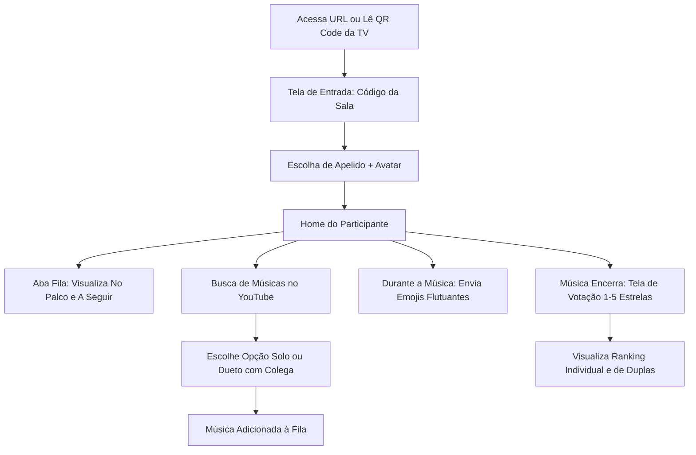

# Karaokê da Festa — Design System & Especificação de UI/UX

**Versão:** 1.0.0  
**Autor:** Senior Designer  
**Status:** Aprovado para Desenvolvimento  
**Stack Visual:** Tailwind CSS v3+, Lucide React, Framer Motion / CSS Keyframes, Canvas-Confetti

---

## 1. Filosofia Visual & Conceito

O **Karaokê da Festa** foi concebido sob a estética **Dark Neon Premium** ("Cyber Lounge / Stage Lights"). 
O objetivo visual é transportar a energia de um palco profissional de karaokê e balada para as telas dos usuários, garantindo altíssima usabilidade em ambientes de pouca luz (salas de festa, bares e salas de estar escuras).

### Pilares de Design
1. **Atmosfera Imersiva:** Fundo escuro profundo com camadas de elevação sutis, enriquecido por gradientes em tons de roxo elétrico, rosa neon e azul ciano com efeitos de luz periférica (*glow*).
2. **Hierarquia Sem Esforço:** Textos com legibilidade impecável para leitura rápida em celulares e visualização à distância (3m a 5m) em TVs.
3. **Sensação de Presença em Tempo Real:** Microinterações dinâmicas, animações táteis, fluxo contínuo de reações flutuantes e transições suaves de palco.
4. **Respeito ao Dispositivo:**
   - **Mobile (Participante):** Ergonomia com alcance facilitado por uma mão, ações primárias na área do polegar, navegação fluida por modais e bottom sheets.
   - **Desktop/Tablet (Organizador):** Alta densidade de informação limpa, controle rápido tipo mesa de som e painel de moderação instantâneo.
   - **TV/Telão (Display Mode):** Zero poluição visual desnecessária, destaque máximo para o vídeo/letra e overlays inteligentes e não obstrutivos.

---

## 2. Paleta de Cores & Configuração Tailwind

A paleta de cores combina um fundo escuro neutro com acentos neon vibrantes e variantes de opacidade para efeitos de vidro (*glassmorphism*).

### 2.1 Tabela de Cores

| Categoria | Nome do Token | Hex / Valor | Uso Principal |
|---|---|---|---|
| **Fundo** | `bg-dark-base` | `#090A10` | Fundo principal da aplicação |
| **Fundo** | `bg-dark-surface` | `#121424` | Cards, containers e superfícies primárias |
| **Fundo** | `bg-dark-elevated` | `#1A1D36` | Modais, dropdowns e cards em hover |
| **Fundo** | `bg-dark-border` | `#2A2E54` | Bordas padrão e divisores sutis |
| **Primária (Neon Purple)** | `brand-purple-light` | `#C084FC` | Acentos e estados hover |
| **Primária (Neon Purple)** | `brand-purple` | `#9333EA` | Botões primários, badges de destaque |
| **Primária (Neon Purple)** | `brand-purple-dark` | `#6B21A8` | Gradientes e sombras de profundidade |
| **Secundária (Electric Pink)**| `brand-pink-light` | `#F472B6` | Destaques de votação e duetos |
| **Secundária (Electric Pink)**| `brand-pink` | `#EC4899` | Chamadas de ação especiais, reações de amor |
| **Secundária (Electric Pink)**| `brand-pink-dark` | `#BE185D` | Gradientes secundários |
| **Acento (Cyber Cyan)** | `brand-cyan-light` | `#67E8F9` | Informações em tempo real e badges |
| **Acento (Cyber Cyan)** | `brand-cyan` | `#06B6D4` | Links, badges de status, botões alternativos |
| **Ouro / Estrelas** | `brand-gold` | `#FBBF24` | Sistema de avaliação (1-5 estrelas), ranking top 1 |
| **Sucesso** | `status-success` | `#10B981` | Conexão ativa, música adicionada, aprovado |
| **Alerta** | `status-warning` | `#F59E0B` | Fila cheia, desconexão momentânea |
| **Erro / Perigo** | `status-danger` | `#EF4444` | Cancelar, remover da fila, banir, pular música |
| **Texto Principal** | `text-primary` | `#F8FAFC` | Títulos, textos principais, cabeçalhos |
| **Texto Secundário** | `text-secondary` | `#94A3B8` | Subtítulos, duração, nomes de canais |
| **Texto Mudo** | `text-muted` | `#64748B` | Dicas secundárias, metadados discretos |

---

### 2.2 Trecho Exportável para `tailwind.config.js`

O desenvolvedor Frontend pode copiar este bloco diretamente para o arquivo `tailwind.config.js`:

```javascript
/** @type {import('tailwindcss').Config} */
module.exports = {
  content: [
    "./index.html",
    "./src/**/*.{js,ts,jsx,tsx}",
  ],
  darkMode: 'class',
  theme: {
    extend: {
      colors: {
        dark: {
          base: '#090A10',
          surface: '#121424',
          elevated: '#1A1D36',
          border: '#2A2E54',
          glass: 'rgba(18, 20, 36, 0.75)',
        },
        brand: {
          purple: {
            DEFAULT: '#9333EA',
            light: '#C084FC',
            dark: '#6B21A8',
            glow: 'rgba(147, 51, 234, 0.45)',
          },
          pink: {
            DEFAULT: '#EC4899',
            light: '#F472B6',
            dark: '#BE185D',
            glow: 'rgba(236, 72, 153, 0.45)',
          },
          cyan: {
            DEFAULT: '#06B6D4',
            light: '#67E8F9',
            dark: '#0E7490',
            glow: 'rgba(6, 182, 212, 0.45)',
          },
          gold: {
            DEFAULT: '#FBBF24',
            light: '#FDE68A',
            glow: 'rgba(251, 191, 36, 0.5)',
          }
        },
        status: {
          success: '#10B981',
          warning: '#F59E0B',
          danger: '#EF4444',
        }
      },
      fontFamily: {
        sans: ['Plus Jakarta Sans', 'Inter', 'system-ui', 'sans-serif'],
        display: ['Outfit', 'Cabinet Grotesk', 'sans-serif'],
      },
      boxShadow: {
        'neon-purple': '0 0 20px -3px rgba(147, 51, 234, 0.5), 0 0 10px -2px rgba(147, 51, 234, 0.3)',
        'neon-pink': '0 0 20px -3px rgba(236, 72, 153, 0.5), 0 0 10px -2px rgba(236, 72, 153, 0.3)',
        'neon-cyan': '0 0 20px -3px rgba(6, 182, 212, 0.5), 0 0 10px -2px rgba(6, 182, 212, 0.3)',
        'neon-gold': '0 0 20px -3px rgba(251, 191, 36, 0.6), 0 0 10px -2px rgba(251, 191, 36, 0.4)',
        'glass': '0 8px 32px 0 rgba(0, 0, 0, 0.37)',
      },
      animation: {
        'pulse-slow': 'pulse 3s cubic-bezier(0.4, 0, 0.6, 1) infinite',
        'float-reaction': 'floatReaction 2.4s ease-out forwards',
        'glow-pulse': 'glowPulse 2s ease-in-out infinite alternate',
      },
      keyframes: {
        floatReaction: {
          '0%': { transform: 'translateY(0) scale(0.6) rotate(0deg)', opacity: '0' },
          '15%': { opacity: '1', transform: 'translateY(-20px) scale(1.15) rotate(-6deg)' },
          '50%': { transform: 'translateY(-120px) scale(1) rotate(6deg)' },
          '100%': { transform: 'translateY(-260px) scale(0.85) rotate(-10deg)', opacity: '0' },
        },
        glowPulse: {
          'from%': { boxShadow: '0 0 10px rgba(147, 51, 234, 0.4)' },
          'to%': { boxShadow: '0 0 25px rgba(236, 72, 153, 0.7)' },
        }
      },
      backdropBlur: {
        xs: '2px',
      }
    },
  },
  plugins: [],
}
```

---

## 3. Tipografia & Espaçamentos

### 3.1 Tipografia

- **Família Display (Títulos & Destaques):** `Outfit` ou `Cabinet Grotesk` (Google Fonts).
  - Títulos de palco, logos, números do pódio e código da sala.
- **Família de Interface (Corpo & Controles):** `Plus Jakarta Sans` ou `Inter` (Google Fonts).
  - Textos de música, nomes de participantes, botões, modais e legendas.

```html
<!-- Inserir no index.html -->
<link rel="preconnect" href="https://fonts.googleapis.com">
<link rel="preconnect" href="https://fonts.gstatic.com" crossorigin>
<link href="https://fonts.googleapis.com/css2?family=Outfit:wght@600;700;800;900&family=Plus+Jakarta+Sans:wght@400;500;600;700&display=swap" rel="stylesheet">
```

#### Escala Tipográfica de Aplicação

| Nível | Classe Tailwind | Tamanho / Line Height | Peso | Uso Recomendado |
|---|---|---|---|---|
| **Display Hero** | `text-4xl md:text-6xl font-display` | 36px a 60px / 1.1 | 800 (Extra Bold) | Código da sala no Telão, Pódio #1 |
| **Display Title** | `text-2xl md:text-3xl font-display` | 24px a 30px / 1.2 | 700 (Bold) | Cantor atual no palco, títulos de páginas |
| **Subtitle / H2** | `text-xl md:text-2xl font-sans` | 20px a 24px / 1.3 | 600 (Semi Bold) | Título de seções, modais |
| **Body Large** | `text-base md:text-lg font-sans` | 16px a 18px / 1.5 | 500 (Medium) | Nome da música nos cards principais |
| **Body Regular** | `text-sm font-sans` | 14px / 1.5 | 400 (Regular) | Artistas, nomes secundários, inputs |
| **Caption / Small** | `text-xs font-sans` | 12px / 1.4 | 500 (Medium) | Duração de música, badges, contadores |

### 3.2 Raios de Borda (*Border Radius*)
- **`rounded-lg` (8px):** Tags, botões pequenos, inputs.
- **`rounded-xl` (12px):** Cards de lista de fila, thumbnails de busca.
- **`rounded-2xl` (16px):** Cards principais de palco, modais, painéis.
- **`rounded-full` (9999px):** Avatares, pílulas de status, botões de ação flutuantes e chips de emoji.

---

## 4. Componentes Base do Design System

### 4.1 Botões Primários e Variantes

```tsx
// 1. Botão Primário Neon (Ações Principais: "Entrar na Sala", "Cantar Esta Música")
<button className="relative group overflow-hidden rounded-xl bg-gradient-to-r from-brand-purple to-brand-pink px-6 py-3.5 font-sans font-semibold text-white shadow-neon-purple transition-all duration-300 hover:scale-[1.02] hover:shadow-neon-pink active:scale-[0.98]">
  <span className="relative z-10 flex items-center justify-center gap-2">
    <Mic className="w-5 h-5" /> Entrar na Fila
  </span>
</button>

// 2. Botão Secundário Glass (Ações Neutras: "Cancelar", "Ver Detalhes")
<button className="rounded-xl border border-dark-border bg-dark-surface/80 backdrop-blur-md px-5 py-3 font-sans font-medium text-text-primary transition-all duration-200 hover:bg-dark-elevated hover:border-brand-purple/40">
  Voltar
</button>

// 3. Botão de Ação de Perigo (Organizador: "Pular Música", "Remover")
<button className="rounded-xl border border-status-danger/30 bg-status-danger/10 px-4 py-2 text-sm font-semibold text-status-danger transition-all hover:bg-status-danger/20">
  Pular Vez
</button>

// 4. Botão Flutuante FAB Mobile ("Adicionar Música")
<button className="fixed bottom-6 right-6 z-40 flex h-14 w-14 items-center justify-center rounded-full bg-gradient-to-tr from-brand-purple to-brand-pink text-white shadow-neon-pink transition-transform hover:scale-110 active:scale-95">
  <Plus className="w-7 h-7" />
</button>
```

### 4.2 Inputs e Seletores

```tsx
// Input de Texto com Foco Neon
<div className="flex flex-col gap-1.5">
  <label className="text-xs font-semibold uppercase tracking-wider text-text-secondary">
    Seu Apelido na Festa
  </label>
  <div className="relative">
    <input 
      type="text" 
      placeholder="Ex: Paulinho do Pagode" 
      className="w-full rounded-xl border border-dark-border bg-dark-surface/90 px-4 py-3.5 text-text-primary placeholder:text-text-muted transition-all focus:border-brand-purple focus:outline-none focus:ring-2 focus:ring-brand-purple/30"
    />
  </div>
</div>

// Input Especial de Código de Sala (6 Dígitos Grandes)
<input 
  type="text" 
  maxLength={6} 
  placeholder="FESTA1" 
  className="w-full text-center tracking-[0.35em] uppercase font-display font-black text-3xl rounded-2xl border-2 border-brand-purple/40 bg-dark-surface/90 py-4 text-brand-purple-light placeholder:text-dark-border focus:border-brand-pink focus:shadow-neon-purple focus:outline-none"
/>
```

### 4.3 Cards de Música na Fila

```tsx
<div className="flex items-center gap-3.5 rounded-xl border border-dark-border/80 bg-dark-surface/80 p-3 transition-all hover:border-brand-purple/40 hover:bg-dark-elevated">
  {/* Posição na fila */}
  <div className="flex h-8 w-8 shrink-0 items-center justify-center rounded-lg bg-dark-base text-sm font-bold text-text-secondary">
    #2
  </div>

  {/* Thumbnail */}
  

  {/* Info da Música */}
  <div className="min-w-0 flex-1">
    <p className="truncate font-semibold text-text-primary text-sm">{song.title}</p>
    <div className="flex items-center gap-2 text-xs text-text-secondary mt-0.5">
      <span className="flex items-center gap-1 text-brand-cyan-light font-medium">
        <Mic className="w-3.5 h-3.5" /> {song.singer.nickname}
      </span>
      {song.duet_singer && (
        <span className="flex items-center gap-1 text-brand-pink-light font-medium">
          + {song.duet_singer.nickname}
        </span>
      )}
    </div>
  </div>

  {/* Tempo / Ação */}
  <span className="shrink-0 text-xs font-mono text-text-muted">
    {formatDuration(song.duration_seconds)}
  </span>
</div>
```

### 4.4 Barra de Reações Flutuantes (Mobile)

Barra fixa ou semi-translúcida com os 6 emojis mapeados no contrato (`CONTRACTS.md`):
- `❤️` (Coração / Amor)
- `🔥` (Fogo / Mandou Bem)
- `👏` (Palmas / Aplausos)
- `🎉` (Festa / Comemoração)
- `⭐` (Estrela / Show)
- `🎤` (Microfone / Cantor Nato)

```tsx
<div className="fixed bottom-4 left-1/2 -translate-x-1/2 z-30 flex items-center gap-2 rounded-full border border-white/10 bg-dark-surface/90 backdrop-blur-xl px-4 py-2 shadow-2xl">
  {['❤️', '🔥', '👏', '🎉', '⭐', '🎤'].map((emoji) => (
    <button 
      key={emoji}
      onClick={() => handleSendReaction(emoji)}
      className="flex h-11 w-11 items-center justify-center rounded-full text-2xl transition-transform hover:scale-125 active:scale-90"
    >
      {emoji}
    </button>
  ))}
</div>
```

---

## 5. Especificação Detalhada das 3 Interfaces

---

### 5.1 Interface 1: Participante (Mobile-First)

#### Fluxo do Usuário Participante


#### Telas & Componentes Específicos:
1. **Entrada na Sala (`/room/:code` ou `/`):**
   - Campo grande centralizado para o código de 6 caracteres (pré-preenchido se vier do QR Code).
   - Campo de apelido (validação de unicidade na sala).
   - Botão "Entrar na Cantoria" com efeito gradiente pulsante.
   - Persistência automática do token de sessão no `localStorage`.

2. **Home do Participante (`/room/:code/stage`):**
   - **Header:** Nome da festa, avatar do participante, badge de status da sala (Ao Vivo / Pausado).
   - **Card "No Palco Agora":**
     - Banner com glow dinâmico.
     - Nome da música e artista original.
     - Nome(s) de quem está cantando com ícone de microfone.
     - Indicador visual animado de equalizador de áudio.
     - Barra de reações flutuantes acessível imediatamente.
   - **Seção "Minhas Músicas":**
     - Lista das músicas que o próprio usuário adicionou, com posição estimada e status (`pendente`, `sua vez a seguir!`).
   - **Seção "Próximos da Fila":**
     - Lista dos próximos 5 cantores com miniaturas do YouTube.
   - **Ação Principal:** Botão Flutuante (FAB) "+" no canto inferior direito para adicionar música.

3. **Modal de Busca e Adição à Fila:**
   - Abre como *Bottom Sheet* deslizante de baixo para cima.
   - Campo de pesquisa com ícone de busca e debounce de 400ms.
   - Lista de resultados do YouTube: miniatura, título, canal e duração.
   - Ao selecionar uma música:
     - Toggle: "Cantar Solo" ou "Cantar em Dueto 👥".
     - Se dueto: dropdown com lista dos participantes presentes na sala (excluindo ele mesmo).
     - Botão de confirmação: "Confirmar e Entrar na Fila".
     - Feedback imediato: Toast de sucesso neon verde com animação.

4. **Overlay de Votação Interativa (Acionado quando `rooms.voting_open = true`):**
   - Um modal *full-screen blur* surge com transição suave.
   - **Se o usuário for o cantor (ou parceiro de dueto):**
     - Mensagem amigável e descontraída: *"Você deu um show no palco! 🎤✨ Aguardando a nota da galera..."*.
     - Indicador de tempo restante da votação (barra de progresso decrescente).
   - **Se o usuário for espectador:**
     - Título: *"O que achou do show de [Nome do Cantor]?"*
     - Componente de 5 estrelas gigantes (`h-14 w-14`), com efeito de hover/tap que acende em dourado neon com vibração (*haptic* em dispositivos compatíveis).
     - Textos de apoio dinâmicos:
       - 1 Estrela: *"Faltou afinação 😅"*
       - 2 Estrelas: *"Tentativa válida! 👏"*
       - 3 Estrelas: *"Mandou bem! 🎶"*
       - 4 Estrelas: *"Voz de ouro! 🔥"*
       - 5 Estrelas: *"PROFISSIONAL! SHOW HISTÓRICO! 🌟"*
     - Ao clicar, confirmação instantânea via RPC `rpc_submit_rating` e mensagem de voto registrado.

5. **Aba de Ranking e Estatísticas:**
   - Abas seletoras: "🎤 Cantores Solo" | "👥 Melhores Duplas".
   - Top 3 em formato de cards de medalhas (Ouro, Prata, Bronze).
   - Média de estrelas com ícone `Star` preenchido e total de pontos acumulados.

---

### 5.2 Interface 2: Organizador (Dashboard Desktop / Tablet)

O Organizador tem controle total sobre o fluxo da festa. A interface é dividida em 3 colunas ergonômicas para rápida tomada de decisão.

```
+----------------------------------------------------------------------------------------------------+
| 🎤 Karaokê da Festa [ADMIN] | Sala: FESTA1 (Ativa) | Auto-Play: [ON] | Votação: [30s] | [Encerrar] |
+------------------------------------+-----------------------------------+---------------------------+
| COLUNA 1: PALCO & PLAYER MASTER    | COLUNA 2: GESTÃO DA FILA          | COLUNA 3: PARTICIPANTES   |
|                                    |                                   |                           |
| [Player YouTube em Miniatura]      | [+ Adicionar Prioritário]         | Participantes: 18 online  |
|                                    |                                   |                           |
| Música Atual: "Evidências"         | 1. "Bohemian Rhapsody"            | - Paulinho (Cantando)     |
| Cantor: Zé & Maria (Dueto)         |    Cantor: Lucas                  | - Maria                   |
| Tempo: 02:45 / 04:12               |    [Subir] [Descer] [VIP] [X]     | - João Silva              |
|                                    |                                   | - Bia                     |
| [◀ Reiniciar] [⏸ Pausar] [▶ Pular]| 2. "Cheia de Manias"              |                           |
|                                    |    Cantor: Carlos + Ana (Dueto)   | Ações Rápidas:            |
| Status da Votação:                 |    [Subir] [Descer] [VIP] [X]     | [Silenciar Chat/Emojis]   |
| [⭐ ABRIR VOTAÇÃO AGORA]           |                                   | [Copiar Link da Sala]     |
| (ou Automático após término)       | 3. "Shallow"                      | [Alterar Regras]          |
|                                    |    Cantor: Fernanda               |                           |
| [Finalizar & Pontuar Performance]  |    [Subir] [Descer] [VIP] [X]     |                           |
+------------------------------------+-----------------------------------+---------------------------+
```

#### Módulos do Organizador:
1. **Header do Painel:**
   - Código da sala com botão de cópia de link de convite.
   - Alternadores rápidos: *Votação Automática* (Sim/Não), *Permitir Duetos* (Sim/Não), *Limite de Músicas por Usuário* (1 a 5).
   - Botão de emergência / pausa geral.

2. **Coluna 1 — Controle do Palco:**
   - Miniatura sincronizada do vídeo oficial que está passando na TV.
   - Controles de reprodução: Play, Pause, Reiniciar, Pular Música.
   - Botões de Votação:
     - `Abrir Votação Agora` (envia broadcast de abertura de votação para a TV e celulares).
     - Contador de votos recebidos em tempo real (ex: *"14 de 18 participantes já votaram"*).
     - `Encerrar Votação & Computar Pontos` (chama `rpc_finish_performance`).

3. **Coluna 2 — Gestão da Fila:**
   - Lista vertical de itens pendentes.
   - Ações por linha:
     - **Tornar VIP / Prioritário:** Marca a música com badge dourada e sobe para o topo da fila.
     - **Reordenar:** Setas de subir/descer (ou drag-and-drop).
     - **Excluir:** Remove a música da fila caso o participante tenha desistido.

4. **Coluna 3 — Moderação de Participantes:**
   - Lista de pessoas conectadas com status de última atividade.
   - Botão para expulsar participante em caso de apelido indevido.
   - Toggle para bloquear reações/emojis de spam temporariamente.

---

### 5.3 Interface 3: TV / Telão (Display Mode - 16:9)

A visualização de TV foi projetada para televisores 1080p e 4K. Não exige toque nem mouse; é puramente informativa e cinematográfica.

#### Estrutura Visual do Telão:
```
+----------------------------------------------------------------------------------------------------+
| 🎵 Karaokê da Festa               SALA: FESTA1               [QR CODE] Aponte a câmera e entre!   |
+----------------------------------------------------------------------------------------------------+
|                                                                                |                   |
|                                                                                |  🎈 REAÇÕES       |
|                                                                                |     AO VIVO       |
|                                                                                |                   |
|                        PLAYER OFICIAL DO YOUTUBE                               |      🔥           |
|                          (VÍDEO COM LETRA / KARAOKÊ)                           |        ❤️         |
|                             [Embed 16:9 Limpo]                                 |      🎤           |
|                                                                                |         👏        |
|                                                                                |       ⭐          |
|                                                                                |                   |
+--------------------------------------------------------------------------------+-------------------+
| 🎤 NO PALCO: João & Camila (Dueto)   |   Música: "Evidências"   |   A SEGUIR: Marcos ("Sweet Child")|
+----------------------------------------------------------------------------------------------------+
```

#### Estados da TV:

1. **Estado Normal (Reprodução da Música):**
   - **Cabeçalho:** Logotipo discreto, código da sala em fonte display grande e QR Code de alta resolução no canto superior direito para novos convidados entrarem a qualquer momento.
   - **Área Central (Player):** Vídeo do YouTube centralizado com proporção 16:9, com cantos arredondados (`rounded-2xl`) e efeito de moldura com luz reativa (*ambient glow* roxo/azul neon).
   - **Overlay Lateral de Reações Flutuantes:** Coluna transparente à direita onde os emojis disparados pelos participantes (`❤️`, `🔥`, `👏`, `🎉`, `⭐`, `🎤`) sobem suavemente com rotações orgânicas e somem no topo.
   - **Rodapé / Lower Third:** 
     - Faixa translúcida elegante com a foto/avatar e nome do cantor atual (ou dos dois cantores caso seja dueto).
     - Indicador "A Seguir: [Nome do Próximo Cantor] com [Nome da Música]".

2. **Estado de Votação (Splash de Fim de Música):**
   - Quando a música acaba e `voting_open = true`:
     - O player diminui ou dá lugar a uma tela cheia festiva.
     - Título dinâmico: *"HORA DA NOTA! 🌟 AVALIEM NO CELULAR!"*
     - Fotos dos cantores em destaque com animação de pulso.
     - Gráfico circular ou barra com contagem regressiva de 30 segundos.
     - Contador dinâmico: *"🔥 16 votos registrados..."* que vibra a cada voto recebido.

3. **Estado de Premiação e Pódio (Hall da Fama da Festa):**
   - Exibido nos intervalos ou sob comando do organizador.
   - Pódio clássico 3D estilizado com 3 degraus:
     - 🥇 **1º Lugar (Centro, mais alto):** Coroa, avatar com borda neon dourada, estrelas médias e pontuação máxima. Disparo de confetes automáticos (`canvas-confetti`).
     - 🥈 **2º Lugar (Esquerda):** Destaque em prata neon.
     - 🥉 **3º Lugar (Direita):** Destaque em bronze/rosa neon.
   - Alternância automática a cada 15 segundos entre "Top Cantores Solo" e "Top Duplas".

---

## 6. Microinterações e Animações Detalhadas

### 6.1 Animação das Reações Flutuantes (CSS Puro)

Esta animação garante 60 FPS mesmo em TVs e celulares mais modestos, sem depender de bibliotecas pesadas:

```css
@keyframes floatUp {
  0% {
    transform: translateY(0) scale(0.6) rotate(0deg);
    opacity: 0;
  }
  15% {
    opacity: 1;
    transform: translateY(-30px) scale(1.2) rotate(-6deg);
  }
  50% {
    transform: translateY(-140px) scale(1) rotate(6deg);
  }
  85% {
    opacity: 0.9;
  }
  100% {
    transform: translateY(-280px) scale(0.8) rotate(-12deg);
    opacity: 0;
  }
}

.reaction-particle {
  position: absolute;
  pointer-events: none;
  animation: floatUp 2.5s cubic-bezier(0.22, 1, 0.36, 1) forwards;
  will-change: transform, opacity;
}
```

### 6.2 Microinteração das Estrelas de Avaliação (1 a 5)

- **Hover/Tap:** A estrela selecionada e todas as anteriores inflam (`scale-125`) e acendem em `#FBBF24` com `shadow-neon-gold`.
- **Efeito de Partículas no 5 Estrelas:** Se o usuário escolher a 5ª estrela, uma explosão sutil de estrelinhas é disparada em volta do botão.
- **Haptic Feedback:** No mobile, acionar `navigator.vibrate(20)` a cada troca de estrela para reforçar a sensação de física.

### 6.3 Celebração com Confetes (`canvas-confetti`)
Para a tela do pódio da TV ou quando um cantor atinge média de 4.8+ estrelas:

```typescript
import confetti from 'canvas-confetti';

export function triggerPodiumCelebration() {
  const duration = 3 * 1000;
  const animationEnd = Date.now() + duration;

  const interval: any = setInterval(function() {
    const timeLeft = animationEnd - Date.now();
    if (timeLeft <= 0) {
      return clearInterval(interval);
    }
    const particleCount = 40 * (timeLeft / duration);
    confetti({
      particleCount,
      origin: { x: randomInRange(0.1, 0.3), y: Math.random() - 0.2 },
      colors: ['#9333EA', '#EC4899', '#06B6D4', '#FBBF24']
    });
    confetti({
      particleCount,
      origin: { x: randomInRange(0.7, 0.9), y: Math.random() - 0.2 },
      colors: ['#9333EA', '#EC4899', '#06B6D4', '#FBBF24']
    });
  }, 250);
}

function randomInRange(min: number, max: number) {
  return Math.random() * (max - min) + min;
}
```

---

## 7. Acessibilidade, Ergonomia & Boas Práticas

1. **Evitar Preto Puro `#000000`:**
   - O uso do fundo escuro profundo `#090A10` com superfícies `#121424` reduz o cansaço visual (*halation effect*) sob monitores OLED e TVs de alta luminosidade em salas escuras.
2. **Alvos de Toque no Mobile:**
   - Todos os botões, itens de menu e estrelas de votação possuem tamanho mínimo de **48x48 pixels** com espaçamento seguro para evitar cliques acidentais.
3. **Contrastes Textuais:**
   - Textos principais utilizam `#F8FAFC` (Slate 50), atingindo proporção de contraste superior a **14:1** em relação ao fundo, ultrapassando os padrões WCAG AAA.
4. **Resiliência a Falhas de Rede:**
   - Estados de carregamento com *skeleton loaders* estilizados em gradiente escuro pulsante (`bg-dark-surface animate-pulse`).
   - Feedback explícito quando a conexão Supabase Realtime estiver instável.

---

## 8. Diretrizes de Implementação para o Frontend Developer

1. **Componentes Recomendados a Criar em `src/components/`:**
   - `ui/Button.tsx`: Botão com variantes `primary`, `secondary`, `danger`, `ghost`.
   - `ui/Input.tsx`: Input estilizado com foco neon e mensagens de erro.
   - `ui/StarRating.tsx`: Componente reutilizável de 1 a 5 estrelas para votação e exibição de notas.
   - `ui/FloatingReactions.tsx`: Gerenciador de partículas e emissor de reações.
   - `ui/Badge.tsx`: Badges de solo, dueto, prioritário e ao vivo.
   - `queue/QueueItemCard.tsx`: Card de música da fila para participante e organizador.
   - `stage/CurrentSongBanner.tsx`: Banner de destaque do cantor e música atual.
   - `tv/PodiumLeaderboard.tsx`: Visualização do pódio com confetes para o telão.
2. **Pacotes Recomendados:**
   - `lucide-react` (Ícones)
   - `canvas-confetti` e `@types/canvas-confetti` (Celebração de vitórias)
   - `clsx` e `tailwind-merge` (Utilitário `cn()` para fusão limpa de classes)
